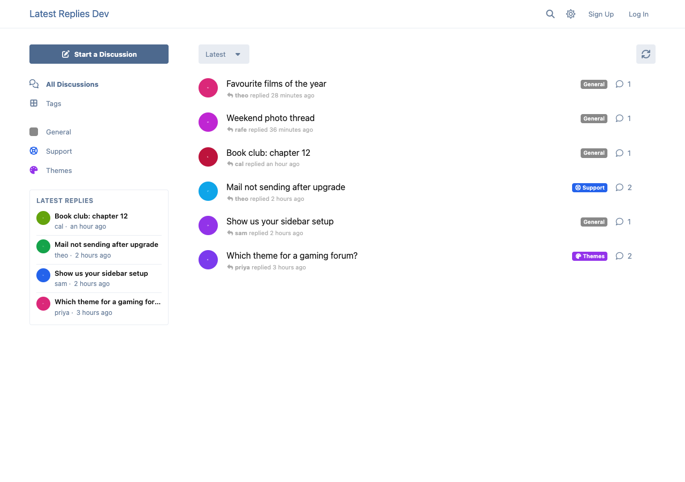
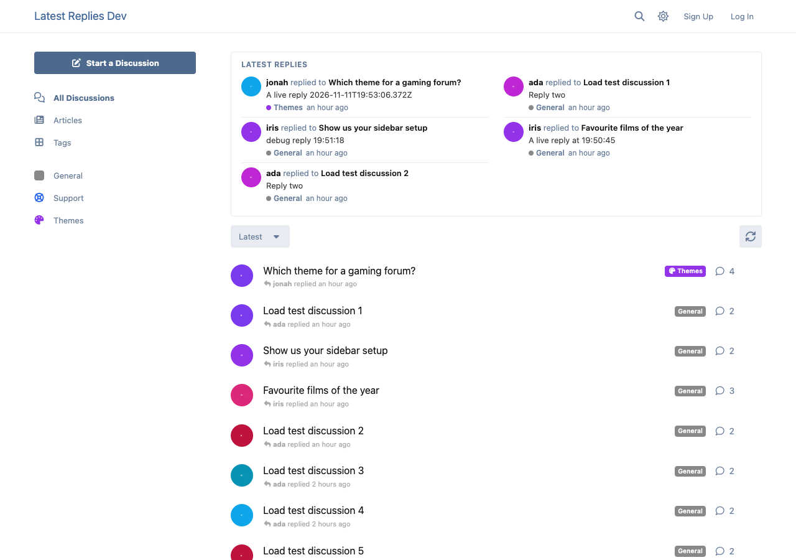

# Latest Replies

A widget of the newest replies on your Flarum 2 forum: in the sidebar, at the top of the discussion list, or beside a discussion. It follows the tag you're viewing, updates live with Realtime, and only ever shows what the reader is allowed to see.

 [](https://packagist.org/packages/ernestdefoe/latest-replies)



- **Where you want it.** In the index sidebar, at the top of the discussion list, or nowhere by default so a widget host places it. It can also sit beside discussions, under the scrubber. On phones, and on layouts with no visible sidebar, the sidebar choice shows at the top of the list, with a Hide switch the reader's browser remembers.
- **Follows the tag.** On a tag's page it lists that tag's replies (its child tags too). Elsewhere, choose tags to list only, or tags to leave out.
- **One row per discussion, or per post.** By default each row is a discussion with its newest reply, so one busy discussion can't fill the list. Switch to one row per post if you'd rather see every reply.
- **Each row** shows the replier's avatar and name, the discussion's title and when, and links straight to that reply. The wide layout adds the tag and an optional excerpt.
- **Excerpts by allow-list.** Only the reply's own words: spoilers, code, quotes, embeds, hidden content and anything unknown are left out. Off by default.
- **Only what the reader may see.** The list comes from Flarum's own API, asked as the reader, so tag permissions, approval, hidden posts and other extensions' privacy rules apply before anything reaches the widget. Private discussions are never listed, not even to their participants. Replies from members the reader ignores ([FoF Ignore Users](https://github.com/FriendsOfFlarum/ignore-users)) are left out; the reply before shows instead.
- **Live.** With [Realtime](https://github.com/flarum/realtime), the list refreshes a few seconds after a new reply. Without it, it refreshes when the reader comes back to the tab after a minute.
- **Widget hosts.** Place it with [Bespoke](https://github.com/ernestdefoe/bespoke) (any zone, with its own title, size and wide rows), [FoF Widgets](https://github.com/FriendsOfFlarum/forum-widgets-core) or [Page Builder](https://github.com/ernestdefoe/page-builder). Wherever one of them shows it, the built-in spot steps aside, and it comes back if you remove it there.
- **Light.** Guests share one cached answer per tag and size, built as a plain guest (so no one visitor's view is ever shared) and refreshed whenever a post, discussion or setting changes. A member's list is one call to the API with a constant number of queries, however many rows. The widget loads after the page is drawn.



## Install

```sh
composer require ernestdefoe/latest-replies
```

## Update

```sh
composer update ernestdefoe/latest-replies
php flarum cache:clear
```

## Links

- [Packagist](https://packagist.org/packages/ernestdefoe/latest-replies)
- [GitHub](https://github.com/ernestdefoe/latest-replies)
- [Buy me a coffee](https://buymeacoffee.com/ernestdefoe)
